# Snake Duel 雙蛇搶食 🐍⚔️

**The snake game that talks back.** Up to five snakes on one board, after the same food. You steer yours with the arrow keys or by swiping. The others are your friends, or AI snakes that ask a real language model where to go, tell you what they think of you, and keep score. It runs in your browser, on your own machine, with the model you choose.

<p align="center">
  <a href="https://youtu.be/NLCrHKpTJ5U">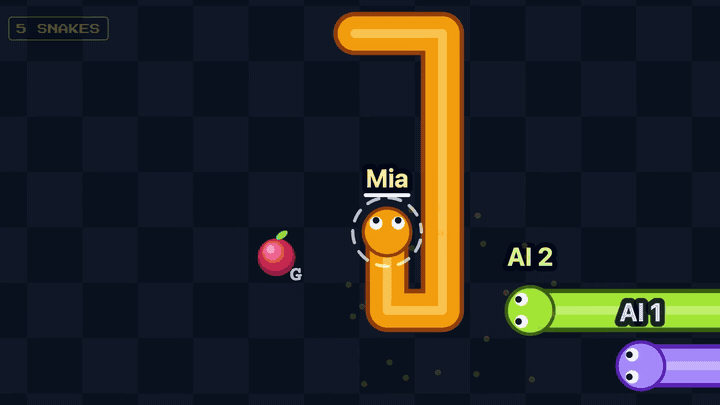</a>
  <br>
  <a href="https://youtu.be/NLCrHKpTJ5U"><b>▶ Watch the film on YouTube</b></a> (2:49, English, recorded live)
</p>

<p align="center">
  <b>Free and open source.</b> <a href="#-get-it"><b>Download it from the Agentic App Store</b></a>
</p>

Built with [Reflex](https://reflex.dev/) for the [re-ddns](https://github.com/milochen0418/re_ddns) Agentic App Store. The opponent is whatever model the [AI Hub](https://github.com/milochen0418/ai_hub) sets for this app: Snake Duel holds no model and no key.

## ✨ What makes it fun

**The other snakes are thinking.** A language model reads the board as text and answers in two lines: where it is heading, and what it wants to say to you. On the board you see its choice as a dashed ring and a dotted line, and beside the board what it said and how long it took. No hidden moves: you can watch an AI make up its mind and get it wrong.

<p align="center">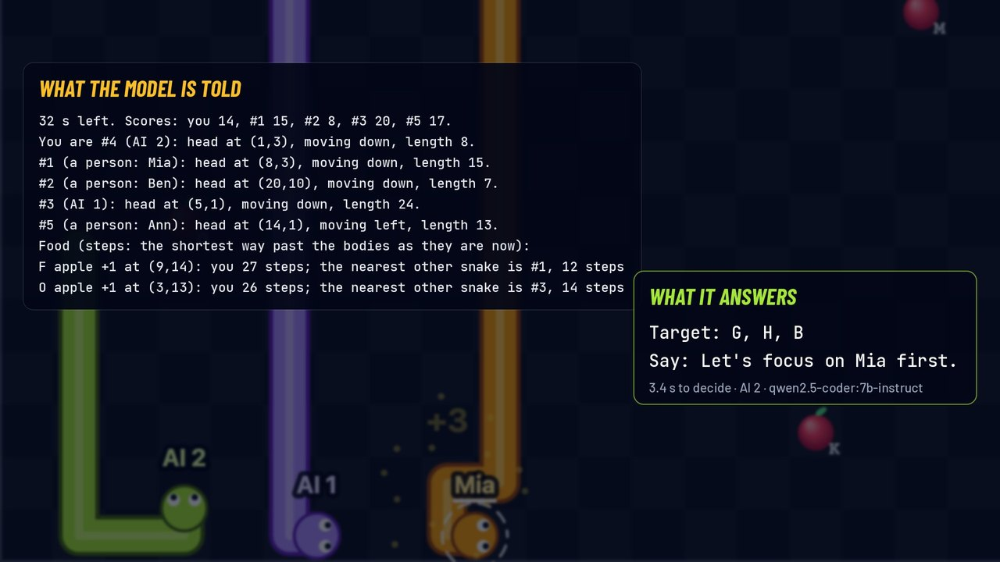</p>

**They talk back.** Every word is the model's own. These all came from one two-minute match, played for the film:

> *"Stay out of my way, Mia and Ben."* · *"Stay clear, food is mine!"* · *"Let's focus on Mia first."* · *"Avoid #1, they're closing fast."* · and with one second left, *"Beware, Mia."*

In that match a person and an AI snake raced side by side for a gold apple. The person got it, and the AI's next words were *"Avoid the gold, focus on apples."*

<p align="center">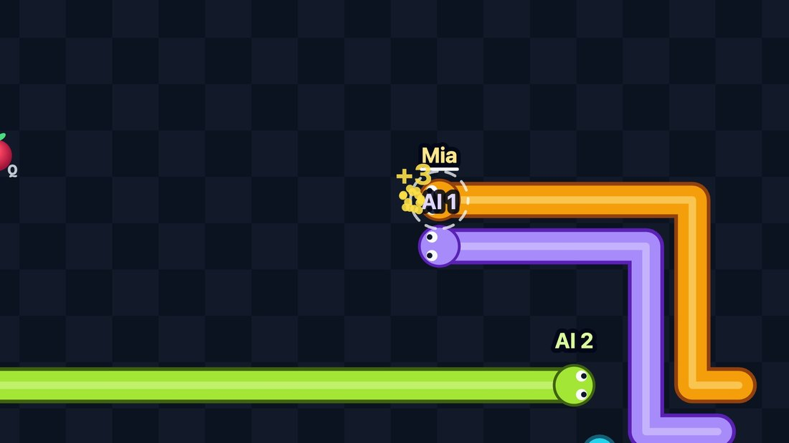</p>

**Better with friends.** Pick 2 to 5 snakes: people take the first seats and AI snakes fill the rest, so two of you in an arena of five means three AI snakes. Open a room and drop its link in your chat, where it unfolds into a card with the board on it. Invite whoever has the game open. Call everyone, and talk while you play.

<p align="center">
  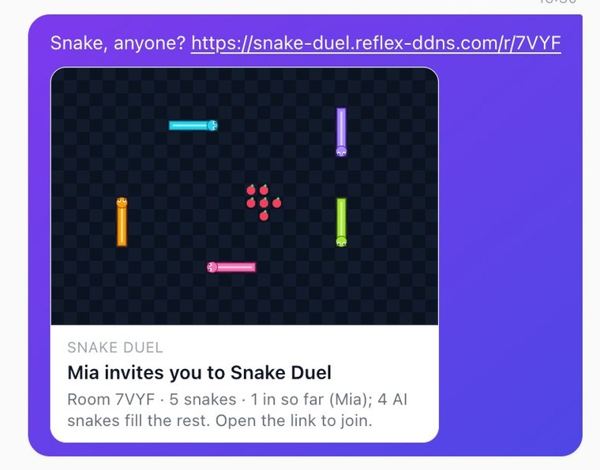
  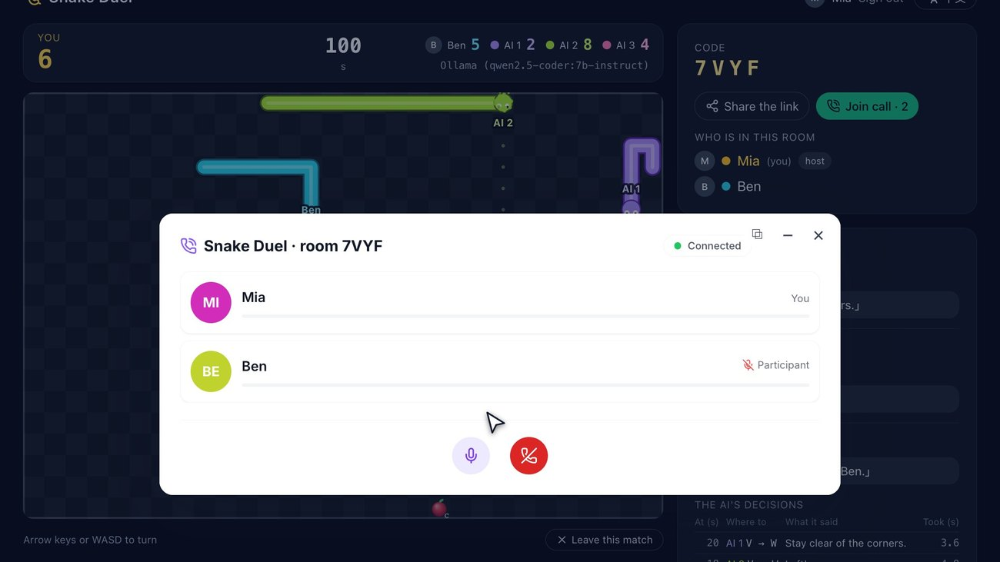
</p>

**A link that always works.** Late? Open it in the middle of the match and watch, or press **Take over** and carry on with an AI snake's score. Lost your connection? An AI plays your snake until you are back. On a phone, swipe on the board.

<p align="center">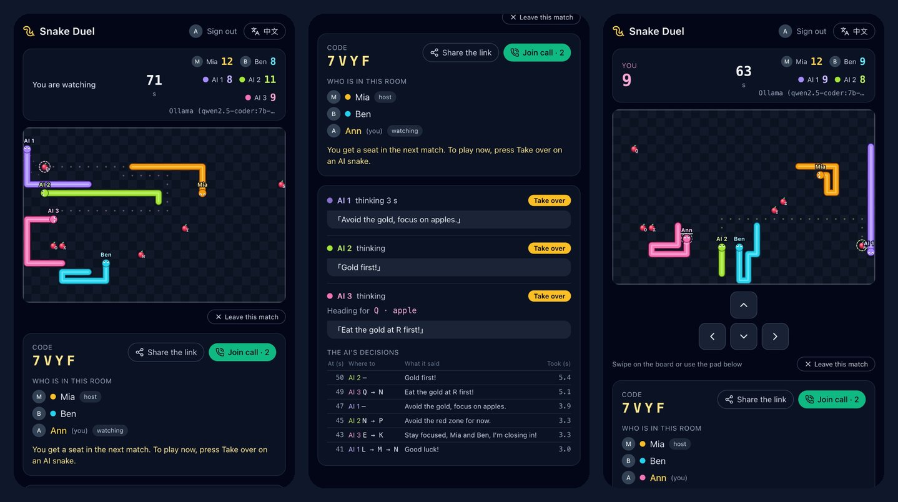</p>

**Which model plays best?** Every match ends with a report, and the scoreboard keeps score per model and arena. Pick another model on the AI Hub and play again. The surprises are the fun of it: speed matters as much as brains, and a one-line rule is hard to beat ([numbers below](#-comparing-models)).

## 🎯 Ways to play

| You want… | Do this |
|---|---|
| A two-minute break | **Play alone** against one AI snake: 2 snakes, 1 minute. One on one it is at its quickest. |
| A game night | Open a room of five, post the link in your group chat, and let AI snakes fill the empty seats. |
| Something to do while everyone joins a call | Share the room, press **Call everyone**, and play while you wait. Latecomers take over an AI snake. |
| To find out what your local model can do | Swap models on the AI Hub, play a few matches each and read the scoreboard. |
| To show people how an AI agent works | Put it on a big screen: the board as text, the model's answer, the seconds it took, and what delay does to it. |
| A warm-up with no AI at all | **Practice snakes** need no model, and make a fair baseline. |

## 🚀 Get it

Snake Duel comes from the **[Agentic App Store](https://milochen0418.github.io/re_ddns/)**, which installs open-source apps on your own computer in one click. It needs Docker Desktop.

```bash
git clone https://github.com/milochen0418/re_ddns.git
cd re_ddns
./rerun_from_zero.sh
```

1. Open `https://aapps.reflex-ddns.com` and press **Install** on *Snake Duel* and on the *AI Hub*.
2. On the AI Hub's page (`https://ai.reflex-ddns.com`) pick a quick model for `snake-duel`, such as a local Ollama model.
3. Open `https://snake-duel.reflex-ddns.com` and play. No model yet? The practice snakes need none.

To run it on its own for development, see [Running it on its own](#-running-it-on-its-own).

## 🎮 How a match goes

<p align="center">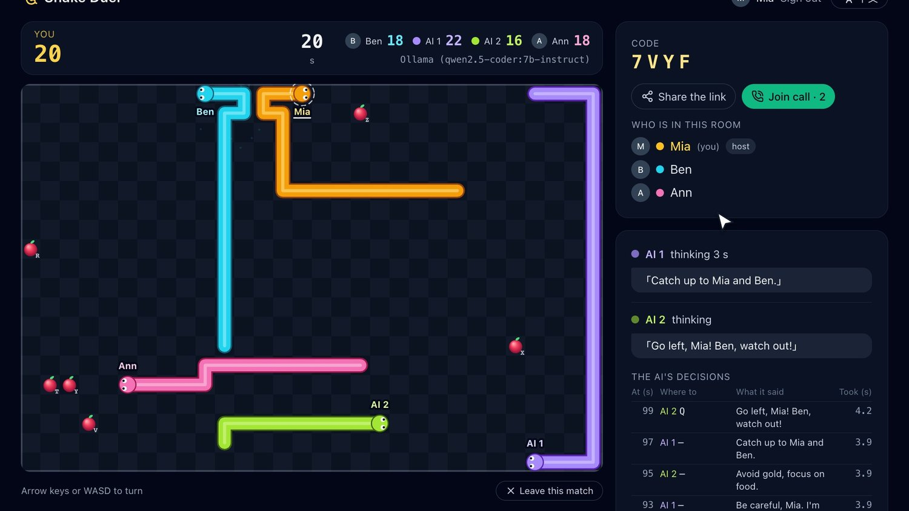</p>

1. The lobby shows what the AI snakes use (the model the AI Hub answers with, or the practice snake), how many snakes the arena holds (2 to 5), the speed (slow, normal, fast: 210, 160 or 120 ms a step) and the length (1 or 2 minutes). **Play alone** starts at once; **Play with people** opens a room with a four-letter code, listed in everyone's lobby with a picture of its board. Whoever joins takes a seat, and the host starts when everyone is in.
2. A 3-second countdown over the starting board, every snake with its name; yours has a line under its name and a dashed ring round its head. With two snakes, on a 24×16 board, they face each other from opposite corners; with more, on a 30×20 board, they start evenly round the middle, all going the same way round. There is always one apple more than there are snakes, placed about as far from every head as the board allows. You can already turn.
3. All snakes move at the same moment, step after step. An apple is worth 1 point, a gold one 3: it shows up every so often, about as far from the two nearest heads, and vanishes after 8 seconds. Eating makes a snake one cell longer.
4. Hitting a wall, yourself or another snake costs 3 points and 2 seconds off the board; the snake comes back somewhere roomy, far from the other heads. When heads meet, all of them lose.
5. If someone's page goes quiet, an AI stands in for them (name and score and all) and hands the snake back when they return, so the arena stays as full as it started.
6. When time is up the places go by points, the same list for everyone in the room. The result shows every snake's place, points, apples, gold ones and crashes, each AI snake's decisions and seconds per decision, and how the AIs did together: how many decisions, how long each took, how many gave nothing and how many were off the format. The host can start another match with the same people, and the match goes onto the lobby's scoreboard.

<p align="center">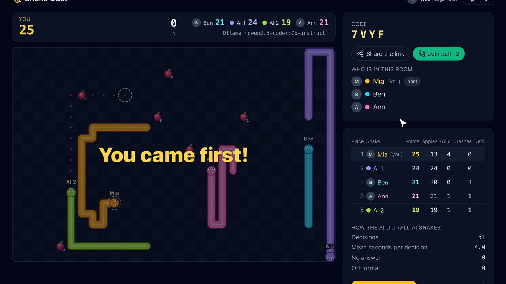</p>

## 🤝 Playing together

**Who is who.** Signed in (the platform's login, through Relack), you go by your account's name and picture; all of your tabs are one person with one snake. Signed in to Relack as a guest, you go by your nickname, one tab at a time. Not signed in, you are a guest of that tab, with a name you type. Everyone's name floats over their snake's head, with their picture, and the room's panel lists who is in, who is offline and who is watching.

**Sharing a room.** The link is `https://snake-duel.reflex-ddns.com/r/CODE`. In a chat it unfolds into a card with the host's name, who is in, how the match stands and a picture of the board (Relack does this by itself: the page behind the link carries OpenGraph tags). On a phone the share button opens the phone's share sheet; elsewhere it copies the link. The room also lists the other people who have the game open, each with an **Invite** button that puts the invitation on their screen.

<p align="center">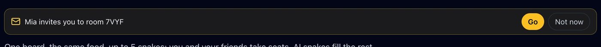</p>

**A link always works.** Whatever anyone is doing when it is opened:

| When the link is opened… | What happens |
|---|---|
| the room is waiting | You are in, and take a seat when it starts. |
| the room is playing | You watch. **Take over** puts you on an AI snake at once; otherwise you get a seat in the next match. |
| the match just ended | You see the result and get a seat in the next match. |
| you are in the middle of your own match | You are asked first, and your match goes on until you say yes. |
| the host is offline (a phone that switched apps to paste the link) | The room waits for them for 10 minutes. After 15 seconds anyone here may start. |
| the room is over | The page says so, and you land in the lobby. |

**Losing the connection.** After 6 seconds an AI stands in for you; you get your snake back the moment you return. A reload keeps your place. Nobody around for 30 seconds calls the match off, and a room nobody comes back to closes after 10 minutes.

<p align="center">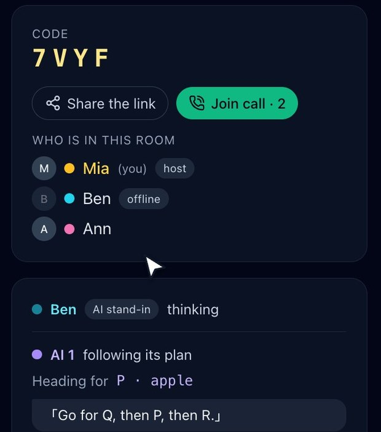</p>

**Call everyone.** Anyone in a room can ring everyone in it. The others get an incoming call over the game (Accept / Decline), and people who come later see *Join call*. The call itself runs in an installed call app (`call.join`: Audio Call, Avatar Call…) in a dialog you can minimize to the tray, still talking, while you play.

## 🧠 How the AI plays

A language model takes a second or more to answer, while the snakes move several times a second, so the AI can't steer each step. It plays like a person thinking ahead instead: it is shown the board from its snake's side (the scores, every snake, every food with how many steps it and the nearest other snake are from it, and one on one a map with coordinates) and answers in two lines:

```
目標：B, D, A          (Target: the food to go for, in order — or a cell, to block)
說：那顆金果是我的！    (Say: a few words to you, shown in a speech bubble)
```

Its snake's body then takes the shortest safe way there by itself: around walls and bodies, keeping off the cells other heads could move into, and never into a pocket too small for it. Once a target is eaten it goes on to the next. The AI is asked again whenever its list runs out, a gold one shows up, or a moment after its last answer; each snake has at most one question out at a time, and the snakes don't wait for it. **Without an answer the snake only dodges: it never goes after food by itself**, so the model's decisions (and how fast they come) are what make it play well.

**Every AI snake asks for itself**, from where it is, with the same model; the AI snakes are rivals, not a team, and they see the people and each other by number. All of them get the same rules text (so a local model can reuse what it already read), and with more than two snakes their boards leave the map out (the steps already go round the bodies). With three snakes asking one Ollama model in turn, the two together halved the wait (qwen2.5:7b on an M4 Pro: 5.2 s → 2.3 s a decision, against 1.4 s with two snakes).

<p align="center">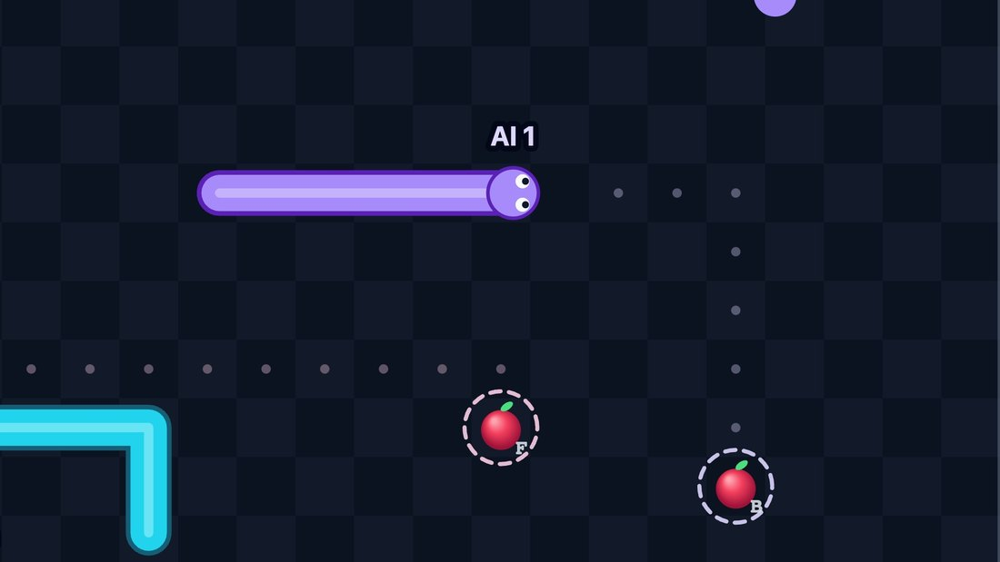</p>

On the page you see where each AI snake is heading (a dashed ring and a dotted line in its colour: blue, violet, green, pink), what it said, the last decisions with their seconds, and how long each has been thinking. A model that thinks before it answers (such as `qwen3.5:9b`) takes most of a minute per decision, so its snake mostly dodges: give Snake Duel a quick model (such as `qwen2.5:7b`) on the AI Hub.

The **practice snake** needs no AI: about once a second it picks, by one simple rule, the nearest food it gets to first. It is there for warming up, for playing without an AI Hub, and as a baseline for the models.

## 🏆 Comparing models

The scoreboard keeps every finished match per opponent and arena (how many snakes, and how many of them people): matches, wins for the people / for the AI snakes / draws (a match goes to the people when a person alone comes first, and is a draw when a person and an AI snake share first place), an AI snake's mean score and crashes per match, and the mean seconds per decision. To try another model, change it on the AI Hub's page (*What each app's AI uses* → `snake-duel`), reload the lobby and play again.

<p align="center">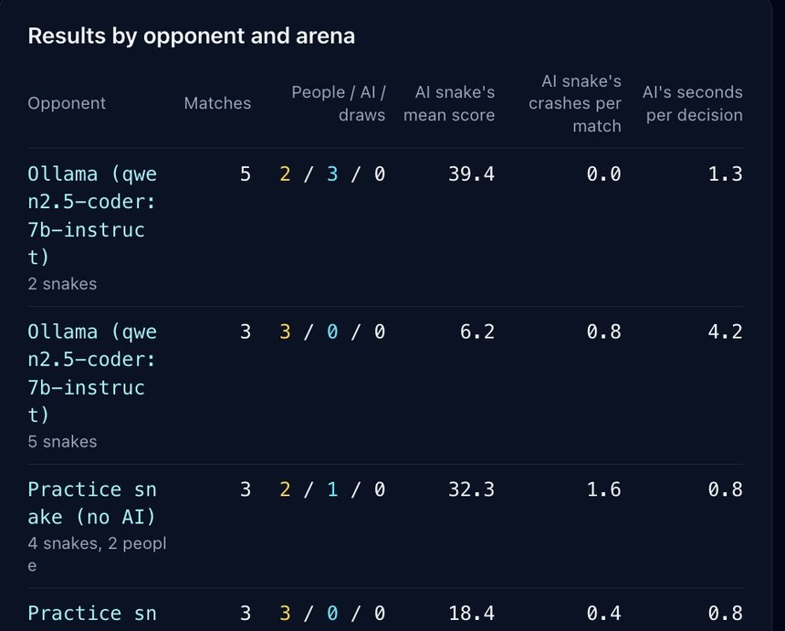</p>

What the film found, with `qwen2.5-coder:7b-instruct` on one Mac:

| Arena | Matches | People / AI | AI snake's mean score | Seconds per decision |
|---|---|---|---:|---:|
| The model, one on one, 2 minutes, against the person who built the game | 5 | 2 / 3 | 39.4 | 1.3 |
| The model, four AI snakes, 1 minute | 3 | 3 / 0 | 6.2 | 4.2 |
| Practice snakes, four of them, 1 minute | 3 | 3 / 0 | 18.4 | 0.8 |

One on one the model is quick and hard to beat. Share it among four snakes and each one waits over four seconds, only dodging meanwhile, and a one-line rule scores three times as much. Think your model can do better? Pick it on the AI Hub and find out.

## 🛠️ How it is built

- `snake_duel/engine.py`: the rules, in plain Python, for 2 to 5 snakes in the seats `s1` … `s5`: a tick moves all snakes at once and settles crashes, food and comebacks; `pilot()` is an AI snake's body (the shortest safe way to a goal, or the most room without one); `greedy()` is the practice snake's rule.
- `snake_duel/brain.py`: what an AI is told (the rules and the board from its snake's side, as text) and `parse()`, which reads its two lines; it asks the AI Hub for the role `fast` through `reflex_ddns_auth.ai`.
- `snake_duel/match.py`: one match as it is played: a seat per snake (a person's, or an AI's with its plan, when to ask again and what each answer did), and `hand_to_ai()` for a person who leaves.
- `snake_duel/rooms.py`: the arenas people share. A room is a plain object in this process, with one task that ticks its match, asks the AIs and keeps the board as JSON; the people in it take the first seats and AI snakes fill the rest. It also knows who else is online, and the invitations on their screens.
- `snake_duel/state.py`: one browser tab. It knows who this is (`AuthState`, else a guest of this tab), its page's heartbeat keeps the person's seat and brings its watcher back after a lost connection, and the watcher copies the board and the scores into that tab's own view.
- `snake_duel/call.py`: Call everyone, through the DDNS Intent `call.join`, as in ReflexGrid.
- `snake_duel/preview.py`, `snake_duel/api.py`: what a shared link answers with: `/r/<code>` (OpenGraph tags, then on into the game) and its picture, drawn cell by cell into a PNG with no imaging library. `backend-paths.txt` tells re-ddns to send `/r/` to the backend.
- `assets/snake_duel/arena.js`: draws the board on a canvas, gliding the snakes between steps, each in its colour, with little bursts for food and crashes; turns swipes and the on-screen pad into arrow keys.
- `snake_duel/history.py`: finished matches as JSON lines in `SNAKE_DUEL_DATA_DIR` (default `~/.local/share/snake_duel`), summed per opponent.
- `snake_duel/views.py`, `snake_duel/i18n.py`: the page, in 繁體中文 and English.

## 🔧 Running it on its own

For development: the practice snake works without anything else. To play an AI, run an AI Hub (see its README) and point the game at it with the same secret:

```bash
poetry env use python3.15
poetry install
DDNS_AI_HUB_URL=http://127.0.0.1:8182 DDNS_AUTH_SECRET=<the hub's secret> SERVICE_SUBDOMAIN=snake-duel \
  SNAKE_DUEL_DATA_DIR=/tmp/snake_duel REFLEX_API_URL=http://localhost:8181 \
  poetry run reflex run --frontend-port 3181 --backend-port 8181
```

## 🧪 Tests

```bash
poetry run pytest                                  # rules, the AI snake's body, the AI's replies, a match, the scoreboard
poetry run ./run_test_suite.sh smoke_home          # the lobby
poetry run ./run_test_suite.sh play_match          # a whole match of two against the practice snake
poetry run ./run_test_suite.sh play_crowd          # a whole match of four, alone against three practice snakes
poetry run ./run_test_suite.sh play_together       # two people in one room, with AI snakes filling the rest
poetry run ./run_test_suite.sh invite_flows        # a link and a connection, whatever anyone is doing
DDNS_AUTH_SECRET=test poetry run ./run_test_suite.sh signed_in   # accounts: names, pictures, several tabs, Relack guests
DDNS_AI_HUB_URL=… DDNS_AUTH_SECRET=… SERVICE_SUBDOMAIN=snake-duel \
  poetry run ./run_test_suite.sh play_ai           # a whole one-on-one match against the hub's model
BASE_URL=https://snake-duel.reflex-ddns.com OUTPUT_DIR=/tmp/snake-call \
  poetry run python testcases/call_everyone/run_test.py   # needs an installed call app
```

See [testcases/README.md](testcases/README.md).

## 🎬 About the film

Recorded live on a real install, in one real two-minute match. Mia, Ann and Ben are made up and scripts steer their snakes; every line an AI says, and every score, is real. Close-ups are redrawn from that match by the game's own drawing code. The game itself is silent, so the sound effects are added, and the voices in the call are text-to-speech.

## License

MIT
